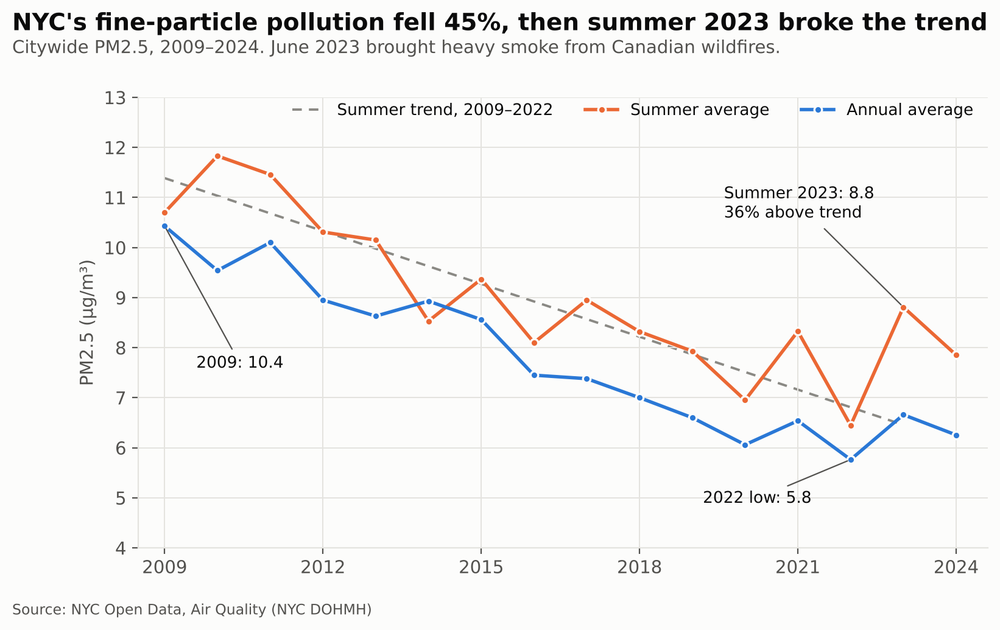
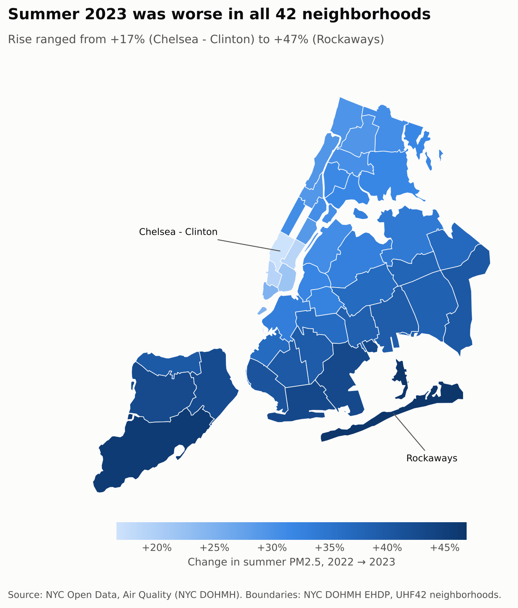
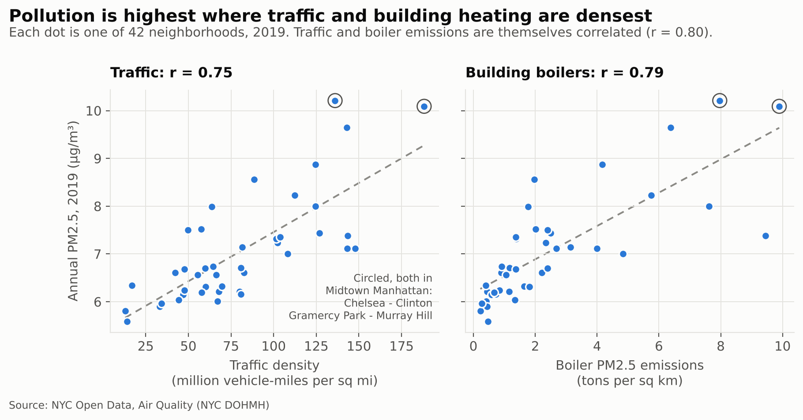
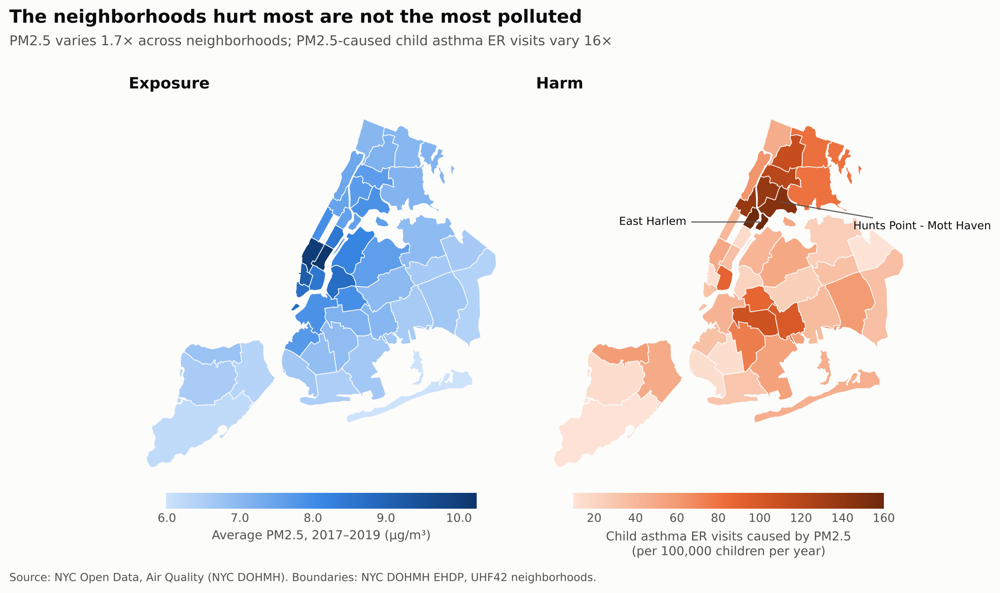

# NYC Air Quality, 2009–2024

**How much cleaner has New York City's air become, what broke the trend in 2023, and who still pays for what's left?**

An analysis of 16 years of the NYC Community Air Survey across 42 neighborhoods. Started as an FBLA data science entry (2nd place); rebuilt as a reproducible project with corrected methods and newer data.

## Findings

**1. Fine-particle pollution fell 45% in 13 years.** Citywide annual PM2.5 dropped from 10.4 µg/m³ in 2009 to 5.8 in 2022. Nitrogen dioxide fell 38%. Summer ozone has not improved (33.7 ppb in 2010, 34.0 in 2024).

**2. Summer 2023 broke the trend, everywhere.** The summer of the Canadian wildfire smoke averaged 8.8 µg/m³, 36% above the 2009–2022 trend and the worst summer since 2017. PM2.5 rose in all 42 neighborhoods, by 17% to 47%.





**3. Pollution concentrates where traffic and building heating are densest.** Across neighborhoods, PM2.5 tracks building-boiler emissions (r = 0.79) and traffic density (r = 0.75). Those two sources track each other just as closely (r = 0.80), so this data can't say which matters more on its own. Both peak in Midtown Manhattan.



**4. The neighborhoods hurt most are not the most polluted.** PM2.5 varies 1.7× across neighborhoods, but the city's estimate of child asthma ER visits caused by PM2.5 varies 16×, and the two are uncorrelated (r = 0.06). The heaviest burden falls on East Harlem, Hunts Point–Mott Haven, and Central Harlem, which breathe moderately polluted air. The same air does far more damage where asthma is already common.



All numbers above are generated by the code; see [`results/summary.md`](results/summary.md).

## Method

- **Data:** [NYC Open Data, Air Quality](https://data.cityofnewyork.us/Environment/Air-Quality/c3uy-2p5r) (NYC Department of Health), 19,827 rows covering pollutant levels, emission sources, and estimated health impacts. Neighborhood boundaries from the [NYC Environment & Health Data Portal](https://github.com/nychealth/EHDP-data). Details in [`data/README.md`](data/README.md).
- **One geography level at a time.** The dataset publishes every indicator at five overlapping levels (citywide, borough, and three neighborhood schemes). Trends use citywide values; comparisons between places use the 42 UHF neighborhoods only.
- **Matched years.** Sources are compared with pollution from the same year (2019, the latest with both traffic and boiler data). Health estimates for 2017–2019 are compared with average PM2.5 over 2017–2019.
- **2023 benchmark.** A straight-line fit to summer averages from 2009–2022 gives the expected summer 2023 value.
- **Statistics:** Pearson correlation, with Spearman rank correlation reported alongside in the results summary as a check against outliers.

## Limitations

- **Correlation, not cause.** Traffic and building emissions are too closely linked across neighborhoods to separate, and no other neighborhood differences are controlled for.
- **Seasonal averages hide the peaks.** The worst smoke days in June 2023 are averaged into the whole summer, so the true spike was sharper than shown.
- **Modeled values.** Pollution levels are model estimates built from the city's monitoring network. Health figures are the city's estimates of impacts attributable to pollution, not counted cases.

## Run it

```bash
git clone https://github.com/tvisham/Air-Quality-Analysis.git
cd Air-Quality-Analysis
pip install -r requirements.txt

python scripts/run_analysis.py      # regenerates figures/ and results/
jupyter notebook notebooks/nyc_air_quality.ipynb   # the guided walkthrough
pytest                              # checks the data and findings
```

The data is included, so no downloads are needed. To pull the latest release from NYC Open Data, run `python scripts/download_data.py`, then rerun the analysis.

## Project layout

```
data/                     air quality CSV and neighborhood boundaries (+ sources)
src/nyc_air/
  data.py                 loading, and selecting one geography level at a time
  analysis.py             the four findings as functions
  plots.py                one figure per finding (maps drawn without GIS libraries)
scripts/
  run_analysis.py         figures + results summary in one command
  download_data.py        refresh the dataset
notebooks/
  nyc_air_quality.ipynb   step-by-step walkthrough with commentary
figures/                  generated charts
results/                  generated summary of every number quoted above
tests/                    data and findings checks
archive/                  the original FBLA notebook
```

## What changed from the original

The [original FBLA notebook](archive/FBLA_Air_Quality_original.ipynb) averaged values across all five geography levels at once and paired indicators from different years. That distorted the correlations: it ranked truck traffic as the clear top source (r = 0.78) and boiler emissions well below it (r = 0.64), when compared properly the two are about equal. This version compares like with like, uses data through 2024 (including the 2023 smoke season the original described but didn't have data for), adds the health-burden analysis, and replaces hardcoded file paths with a pipeline anyone can run.
